# Crack the Hash -- TryHackMe Writeup

**Difficulty:** Easy  
**Category:** Password Cracking / Hash Analysis

## Introduction
Crack the Hash covers the fundamentals of hash cracking and is divided into two levels, each containing several hashes to crack. The first level consists of unsalted hashes, which are faster and easier to crack, while the second level raises the difficulty by introducing salted hashes. Working through both reinforces how to identify a hash type, choose the right cracking tool, and understand why some algorithms resist brute-forcing far better than others.

## Quick Note
Since I had already worked on this room before, I cleared the contents of John the Ripper's pot file to remove any previously cracked passwords related to this challenge. For some of the questions I also saved the hashes in separate files.

## Level 1
Below are the questions and answers for the Level 1 section.

### Question 1
The hash to crack is:
```
48bb6e862e54f2a795ffc4e541caed4d
```

Tools like `hashid` or `hash-identifier` can identify the likely hash type. For this example I used `hash-identifier`:
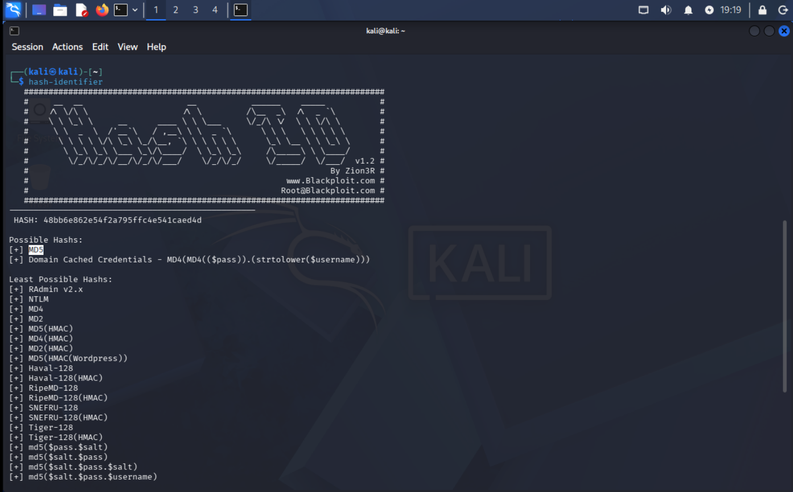

- The results indicate the hash is most likely either an MD5 hash or a Windows Domain Cached Credentials hash.

Saving the hash to a file (`hashes.txt`), John the Ripper cracks it:
```
john --format=Raw-MD5 --wordlist=/usr/share/wordlists/rockyou.txt hashes.txt
```

- `--format=Raw-MD5` specifies the format John uses. This is optional, since John can detect the hash type in most cases.
- `--wordlist=/usr/share/wordlists/rockyou.txt` specifies the wordlist John hashes and compares against the target to find a match.
- `hashes.txt` contains the hash.

The cracked value is:
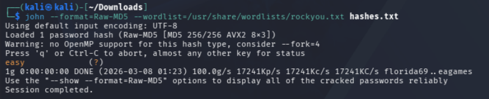


### Question 2
The next hash is:
```
CBFDAC6008F9CAB4083784CBD1874F76618D2A97
```

Using `hash-identifier` to determine the type:
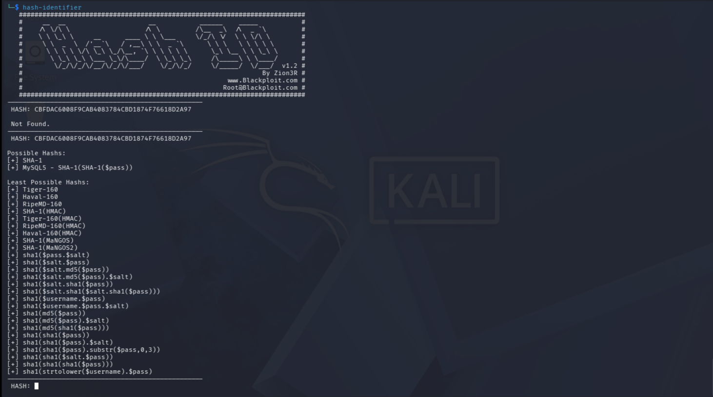

- The results indicate this is most likely a SHA-1 hash or a MySQL SHA-1 hash.

Saving it to `hash.txt`, John the Ripper cracks it:
```
john --format=Raw-SHA1 --wordlist=/usr/share/wordlists/rockyou.txt hash.txt
```

The cracked value is:


### Question 3
The next hash is:
```
1C8BFE8F801D79745C4631D09FFF36C82AA37FC4CCE4FC946683D7B336B63032
```

Using `hash-identifier`, the hash is most likely a SHA-256 hash:
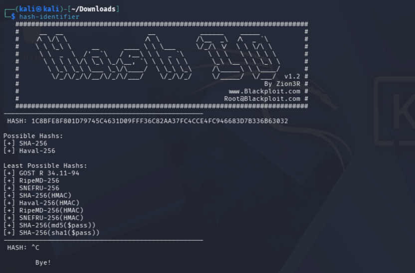

Using this format with John the Ripper, the cracked value is letmein:


### Question 4
The next hash is:
```
$2y$12$Dwt1BZj6pcyc3Dy1FWZ5ieeUznr71EeNkJkUlypTsgbX1H68wsRom
```

Using `hashid`, this format is likely a Blowfish (BSD) hash:
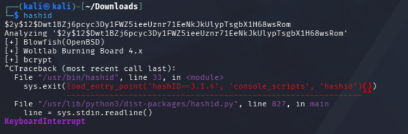

These hashes are deliberately slow to crack. John the Ripper is CPU-based and optimized for machines without powerful GPUs, so for this question I used `hashcat` instead, since my machine has a decent GPU:
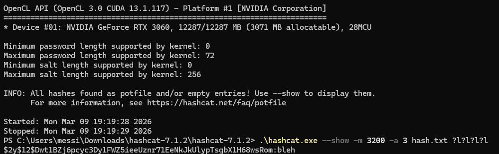

The syntax breaks down as follows:
- `--show` tells hashcat to display the value of the cracked password.
- `-m 3200` sets the hash mode. Similar to John's `--format`, it specifies the hash type. All supported hashes are listed in the [hashcat example hashes](https://hashcat.net/wiki/doku.php?id=example_hashes) reference.
- `-a 3` sets the attack mode, in this case a mask attack, where a password pattern is specified for hashcat to work through.
- `?l?l?l?l` is the mask, covering all combinations of four lowercase characters.

The hash evaluates to bleh:


### Question 5
The final hash is:
```
279412f945939ba78ce0758d3fd83daa
```

I was unable to crack this hash on both my virtual machine and personal computer due to a technical issue, so I used [CrackStation](https://crackstation.net/) to recover the plaintext:
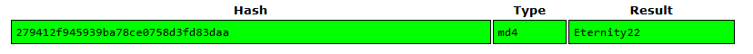

- CrackStation checks a hash against a large database of previously cracked hashes and common passwords, allowing quick recovery of the plaintext without running a brute-force attack of your own.

## Level 2
These are the questions and answers for Level 2.

### Question 1
The hash to crack is:
```
F09EDCB1FCEFC6DFB23DC3505A882655FF77375ED8AA2D1C13F640FCCC2D0C85
```

Using `hash-identifier`, this is either a SHA-256 or a Haval-256 hash:
.png)

Using the SHA-256 format with John the Ripper, the hash evaluates to paule:
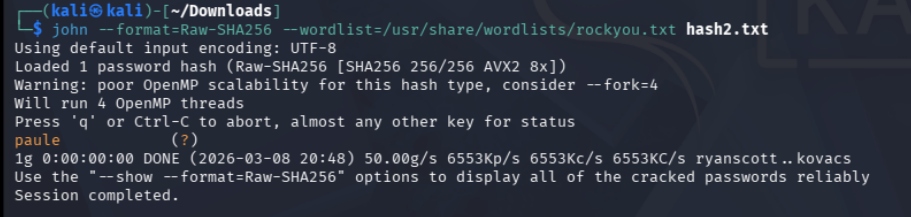


### Question 2
The next hash is:
```
1DFECA0C002AE40B8619ECF94819CC1B
```

`hash-identifier` suggested either an MD5 hash or a Domain Cached Credential hash. Since this hash pattern resembles several other formats, I tested a few possibilities and, through trial and error, confirmed it was actually an NTLM hash.
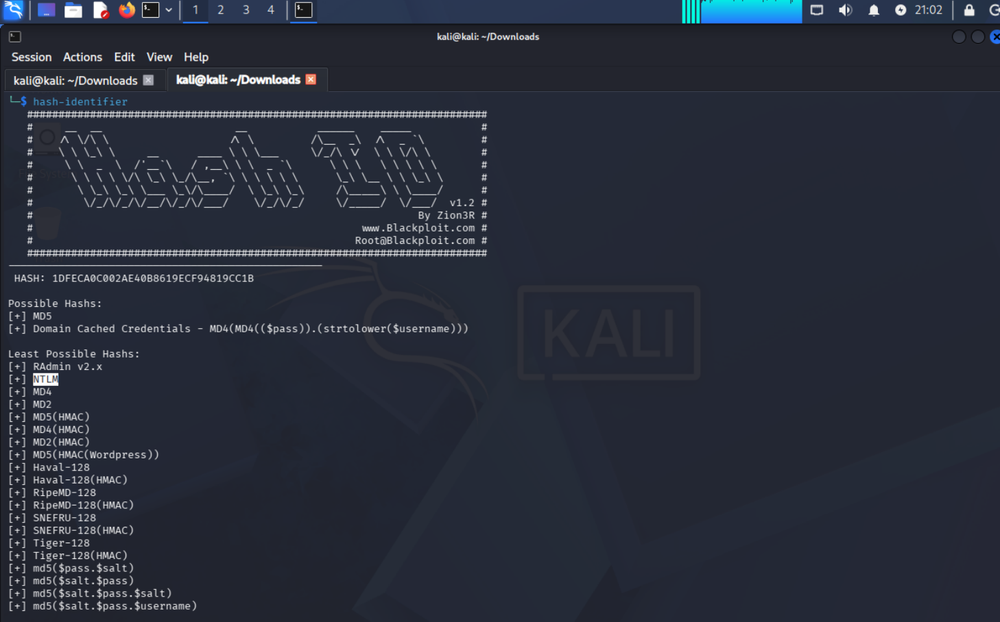

Using that format with John the Ripper, the hash evaluates to n63umy8lkf4i:
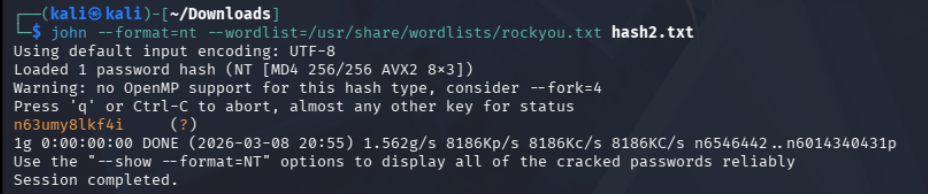


### Question 3
The next hash is:
```
Hash: $6$aReallyHardSalt$6WKUTqzq.UQQmrm0p/T7MPpMbGNnzXPMAXi4bJMl9be.cfi3/qxIf.hsGpS41BqMhSrHVXgMpdjS6xeKZAs02.
Salt: aReallyHardSalt
```

Using `hashid`, this is a SHA-512 Crypt hash:
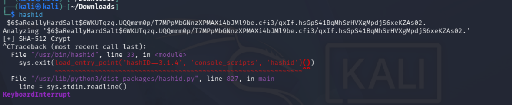

- Tools like `hashid` and `hash-identifier` infer the hash type from its format and structure. Some salted hashes can still be identified if the algorithm has a recognizable pattern.
- The `$6` prefix gives away the algorithm (SHA-512).

Using this format, the hash evaluates to waka99:
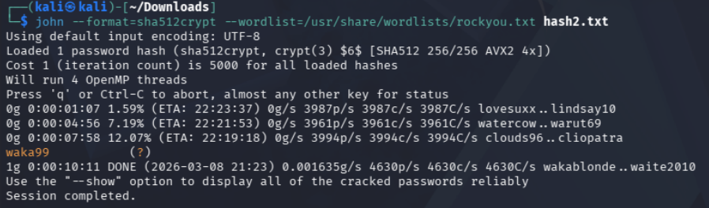

### Question 4
The final hash is:
```
Hash: e5d8870e5bdd26602cab8dbe07a942c8669e56d6
Salt: tryhackme
```

As with Question 2, `hash-identifier` was inconclusive, so after some trial and error I found this was a SHA-1(HMAC) hash. Using hashcat, it evaluated to 481616481616:
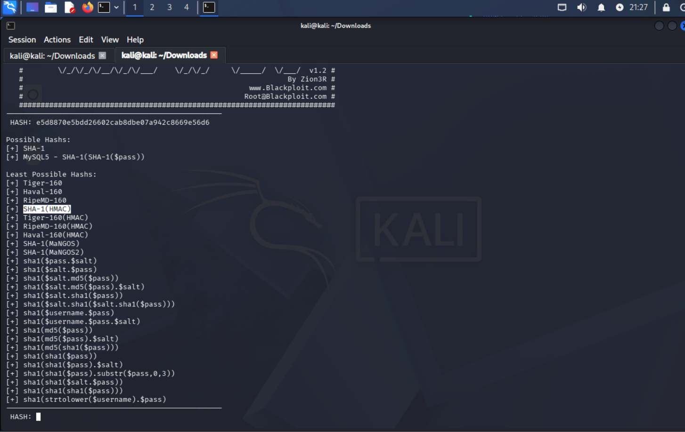
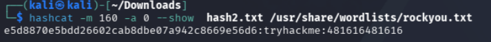


## Lessons Learned
- **Hash identification is the important first step.** Tools like `hashid` and `hash-identifier` narrow down the possible algorithms by analyzing the hash's format and structure. They only provide likely matches, however, so testing multiple formats is sometimes necessary.
- **Different algorithms require different cracking strategies.** Simpler hashes such as MD5, SHA-1, and SHA-256 often fall quickly to common wordlists like `rockyou.txt`, while stronger algorithms like bcrypt (Blowfish) are intentionally designed to slow brute-force attacks.
- **Salted hashes increase cracking difficulty.** Adding a unique salt to each password before hashing defeats precomputed attacks such as rainbow tables, forcing an attacker to compute hashes for each guess individually.
- **John the Ripper and Hashcat are optimized differently.** John is typically CPU-based and strong for quick tests and automated hash detection, while Hashcat is GPU-accelerated and much faster for large or computationally expensive cracking tasks.
- **Online databases can crack weak hashes instantly.** Services like CrackStation compare hashes against large databases of previously cracked passwords, a stark demonstration of the danger of weak or common passwords.
- **Recognizable prefixes speed things up.** A prefix such as `$6$` for SHA-512 Crypt reveals the algorithm immediately, without relying entirely on identification tools.

## Tools Used
- John the Ripper — Dictionary and brute-force password cracking with automated hash detection.
- Hashcat — High-performance, GPU-accelerated password cracking with advanced attack modes.
- hashid — Identifies the possible type of a hash based on its structure.
- hash-identifier — Compares hashes against known patterns to suggest possible algorithms.
- CrackStation — Online hash cracking service backed by a large database of previously cracked passwords.
- rockyou.txt — Widely used password wordlist for dictionary attacks.
